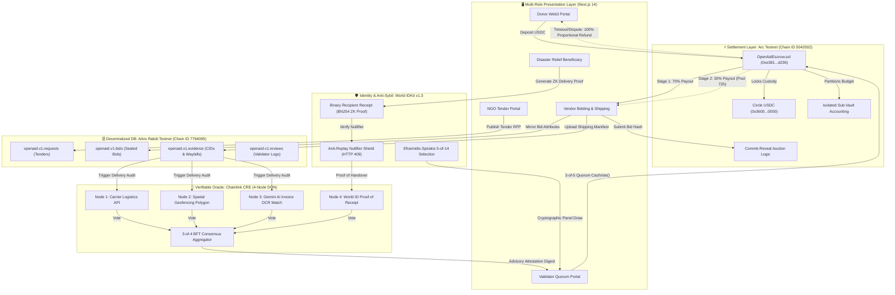

# OpenAid Protocol

[](https://github.com/TechHead25/EthGlobal_Pravaha/actions/workflows/ci.yml)
[](https://opensource.org/licenses/MIT)
[](https://soliditylang.org/)
[](https://hardhat.org/)
[](https://nextjs.org/)
[](https://pravahaprotocol.vercel.app/)

> **A decentralized charitable procurement and staged settlement protocol separating custody, procurement, verification, and settlement to eliminate single points of trust in humanitarian aid.**
>
> 🌐 **Live DApp:** [https://pravahaprotocol.vercel.app](https://pravahaprotocol.vercel.app/)<br/>
> ⚡ **Arc Testnet Escrow:** [`0xe38151283e55077F621988679f2Cc524b785d236`](https://testnet.arcscan.app/address/0xe38151283e55077F621988679f2Cc524b785d236)

> [!IMPORTANT]
> **ETHGlobal Mumbai Judges & Partner Track Reviewers:**  
> For comprehensive architectural breakdowns, live contract addresses on ArcScan, code maps, and step-by-step terminal verification commands for **Arc**, **World**, **Arkiv**, and **Chainlink CRE**, see:  
> 📑 **[`docs/PARTNER_VERIFICATION_GUIDE.md`](./docs/PARTNER_VERIFICATION_GUIDE.md)**  
> Verify all 99 automated partner tests in seconds: `npm run test:partners`

---

## 1. Executive Overview

Traditional humanitarian and charitable aid systems suffer from severe opacity, high administrative overhead, and the constant risk of fund misappropriation. In typical setups, non-governmental organizations (NGOs) or charitable entities maintain unilateral custody over donated capital, allowing bad actors or compromised accounts to siphon or misallocate donations with minimal auditability.

**OpenAid Protocol** re-architects disaster relief and charitable procurement as a trust-minimized, multi-actor state machine deployed on EVM-compatible blockchains. It enforces a strict separation of powers between:
- **Donors:** Provide purpose-bound capital locked directly in smart contract escrow.
- **NGOs / Campaign Creators:** Define relief specifications, budget ceilings, and delivery criteria without touching custody of funds.
- **Vendors / Suppliers:** Compete via sealed commit–reveal auctions to supply relief goods at verified market rates.
- **Independent Validators:** Verify physical evidence manifests off-chain and attest on-chain via quorum consensus.

### The Cardinal Rule
**No participant—not even the campaign creator or protocol deployer—can unilaterally withdraw or redirect campaign funds to an arbitrary address.** Escrowed capital is programmatically locked and can only flow directly to a winning vendor following verified delivery and challenge clearance, or return to original donors if requirements fail.

---

## 🏆 Partner Bounties & Hackathon Judge Quick Guide

> **For ETHGlobal Mumbai Partners & Evaluators:** Direct pointers to specific required folders, live testnet deployments, rubrics, and feedback files. See full details in [`docs/PARTNER_VERIFICATION_GUIDE.md`](./docs/PARTNER_VERIFICATION_GUIDE.md).

| Partner Track | Target Evaluation Folder / Link | Key Deliverables & Rubric Fulfillment | Automated Test Command |
| :--- | :--- | :--- | :--- |
| **Arkiv Network**<br>*($15k Track)* | **[`/arkiv/`](./arkiv/)**<br>and [`docs/ARKIV_INTEGRATION_GUIDE.md`](./docs/ARKIV_INTEGRATION_GUIDE.md) | • **Developer Feedback (25%):** [`arkiv/friction.md`](./arkiv/friction.md)<br>• **Why Arkiv vs Postgres (25%):** [`arkiv/why-arkiv.md`](./arkiv/why-arkiv.md)<br>• **Ecosystem Reach (25%):** [`arkiv/reach.md`](./arkiv/reach.md)<br>• **Entity Architecture:** [`arkiv/how-you-use-arkiv.md`](./arkiv/how-you-use-arkiv.md)<br>• **Rabdi Testnet Schemas:** `openaid.v1.*` (requests, bids, evidence, reviews) | `npm run test:arkiv` *(21 tests pass)* |
| **Arc (Circle)**<br>*($15k Track)* | **[`contracts/core/OpenAidEscrow.sol`](./contracts/core/OpenAidEscrow.sol)**<br>and [`docs/ARC_SECURITY_AUDIT.md`](./docs/ARC_SECURITY_AUDIT.md) | • **Deployed Contract:** [`0xe38151283e55077F621988679f2Cc524b785d236`](https://testnet.arcscan.app/address/0xe38151283e55077F621988679f2Cc524b785d236) (Chain ID `5042002`)<br>• **Official Arc USDC:** [`0x3600000000000000000000000000000000000000`](https://testnet.arcscan.app/address/0x3600000000000000000000000000000000000000)<br>• **Deployment Tx:** Block #70917303 ([`0xd4748a...`](https://testnet.arcscan.app/tx/0xd4748a53c1eedce5bc86293d3d5a570764fae0996d0eb2b906c0ea13d54e7b21))<br>• **Flattened Contract:** [`deployments/OpenAidEscrow_Flattened.sol`](./deployments/OpenAidEscrow_Flattened.sol) | `npm run test:arc`<br>`npm run test:contracts` |
| **Chainlink CRE**<br>*($5k Track)* | **[`/chainlink-cre/`](./chainlink-cre/)**<br>and [`docs/CHAINLINK_CRE_INTEGRATION_GUIDE.md`](./docs/CHAINLINK_CRE_INTEGRATION_GUIDE.md) | • **CRE Workflow SDK:** [`chainlink-cre/workflow.ts`](./chainlink-cre/workflow.ts) + [`workflow.yaml`](./chainlink-cre/workflow.yaml)<br>• **Multi-Node DON Simulator:** [`chainlink-cre/simulate.ts`](./chainlink-cre/simulate.ts) (2/3 BFT consensus)<br>• **Carrier & Spatial Geofence:** Haversine geofence + carrier waybill checks | `npm run test:cre` *(4 tests pass)* |
| **World ID**<br>*($12.5k Track)* | **[`src/lib/worldid/`](./src/lib/worldid/)**<br>and [`docs/WORLD_ID_INTEGRATION_GUIDE.md`](./docs/WORLD_ID_INTEGRATION_GUIDE.md) | • **Anti-Sybil Validator Council:** World IDKit v1.3 ZK verification<br>• **Nullifier Uniqueness:** Double-voting defense preserving reviewer privacy | `npm run test:worldid` *(5 tests pass)* |

---

## 2. Core Protocol Architecture & Workflow

### 2.1. System Architecture & Partner Trust Boundaries



### 2.2. Protocol State Machine

```
[ Donors ] -- (1. Fund Campaign) --> [ Escrow Vault ]
                                            |
[ NGO ] ---- (2. Create Campaign & RFP) --->|
                                            v
[ Vendors ] - (3. Commit/Reveal Bids) -> [ Lowest Valid Bid Selected ]
                                            |
[ Vendor ] -- (4. Ship Goods & Submit IPFS Manifest)
                                            |
[ Validators (3/5 Quorum) ] - (5. Review Evidence & Cast Attestation Vote)
                                            |
                                  [ Quorum Reached? ]
                                   /               \
                             YES  /                 \ NO / Timeout
                                 v                   v
            [ Stage 1: 70% Immediate Release ]   [ 100% Refund to Donors ]
                                 |
                     [ 72h Challenge Window ]
                      /                    \
              No Dispute                  Disputed / Upheld
                  v                              v
   [ Stage 2: 30% Final Release ]        [ 30% Refund to Donors / Vendor Penalized ]
```

1. **Campaign Creation & Direct Escrow Funding:** An NGO creates a campaign defining supply requirements, budget ceiling, delivery location, and deadlines. Donors deposit ERC-20 tokens directly into the immutable escrow contract.
2. **Commit–Reveal Procurement Auction:** Qualified vendors submit cryptographic bid commitments (`hash(price, salt, vendorAddress)`), followed by a reveal phase. The protocol selects the lowest valid revealed bid and locks the winning vendor.
3. **Delivery Evidence Submission:** The winning vendor fulfills the physical delivery and uploads tamper-evident multi-angle photo, GPS, and bill-of-lading evidence manifests to IPFS, committing the root IPFS CID to the contract.
4. **Independent Quorum Attestation:** A decentralized validator set (initially 3-of-5 threshold) inspects evidence off-chain and casts on-chain verification votes.
5. **Staged Settlement & Challenge Window:**
   - **Tranche 1 (70%):** Released immediately to the vendor upon 3-of-5 quorum attestation.
   - **Challenge Period:** A timelock window opens during which any participant may challenge delivery claims with counter-evidence.
   - **Tranche 2 (30%):** Automatically released to the vendor upon challenge period expiry without an active, upheld dispute. If a dispute is substantiated, the remaining funds revert to donors.

---

## 3. Technology Stack

- **Smart Contracts:** Solidity (`^0.8.24`), OpenZeppelin Contracts v5.x (`SafeERC20`, `ReentrancyGuard`, `ECDSA`).
- **Development & Testing:** Hardhat, TypeScript, Ethers.js v6 / Viem.
- **Frontend Application:** Next.js 14 (App Router), React, TypeScript, Tailwind CSS design tokens, Radix UI primitives (shadcn-style components), Lucide Icons, Framer Motion, Sonner, React Hook Form + Zod, TanStack Table.
- **Identity & Access:** Google OAuth via Auth.js v5, PostgreSQL (Prisma) role store with audited, admin-reviewed role requests. See [`docs/AUTH_SETUP.md`](./docs/AUTH_SETUP.md).
- **Wallet & Chain Interaction:** ethers.js v6 with an injected EIP-1193 wallet on Arc Testnet.
- **Decentralized Storage:** IPFS (via Pinata / Web3.Storage) for content-addressed evidence manifests.
- **CI / CD Automation:** GitHub Actions.

---

## 4. Current Status & Implementation Roadmap

| Milestone | Scope | Status |
| :--- | :--- | :--- |
| **M0: Pre-Development Foundation** | Architecture, PRD, threat modeling, state machine specs, interfaces, agent rules | **Complete** |
| **M1: Core Smart Contracts** | `EscrowSettlement`, `CampaignRegistry`, `ProcurementAuction`, `ValidatorRegistry` | In Progress |
| **M2: Contract Test Suite** | Hardhat unit, integration, invariant, and adversarial negative tests | Pending M1 |
| **M3: Frontend & Web3 Integration** | Next.js role-based portal (Donor, NGO, Vendor, Validator dashboards) | Pending M1 |
| **M4: Storage & Evidence Pipeline** | IPFS hashing, manifest serialization, metadata pinning | Pending M3 |
| **M5: End-to-End Demo & Verification** | Local testnet scripted run, edge-case failure demonstrations | Final Stage |

---

## 5. Repository Documentation Index

All technical, security, partner integration, and operational documentation is indexed below:

### 🏆 Partner Bounties & Integration Guides
- [`docs/PARTNER_VERIFICATION_GUIDE.md`](./docs/PARTNER_VERIFICATION_GUIDE.md) — Master Partner Verification Guide for hackathon judges (Arkiv, Arc, Chainlink CRE, World ID).
- [`arkiv/`](./arkiv/) — Arkiv Developer Subfolder:
  - [`arkiv/friction.md`](./arkiv/friction.md) — Actionable feedback on developer friction, CI mocking, and SDK improvements (25% judging weight).
  - [`arkiv/why-arkiv.md`](./arkiv/why-arkiv.md) — Architectural rationale: Why Arkiv over PostgreSQL / Web2 DBs (25% judging weight).
  - [`arkiv/reach.md`](./arkiv/reach.md) — Target audience, ecosystem utility, and DePIN/public goods reach (25% judging weight).
  - [`arkiv/how-you-use-arkiv.md`](./arkiv/how-you-use-arkiv.md) — Entity schemas (`openaid.v1.*`), query filters, and client integration.
- [`docs/ARKIV_INTEGRATION_GUIDE.md`](./docs/ARKIV_INTEGRATION_GUIDE.md) — Full technical integration guide for Arkiv Network on Rabdi Testnet.
- [`docs/ARC_SECURITY_AUDIT.md`](./docs/ARC_SECURITY_AUDIT.md) — Comprehensive security audit, live deployment verification, and USDC accounting on Arc Testnet.
- [`chainlink-cre/README.md`](./chainlink-cre/README.md) & [`docs/CHAINLINK_CRE_INTEGRATION_GUIDE.md`](./docs/CHAINLINK_CRE_INTEGRATION_GUIDE.md) — Decentralized delivery manifest and spatial geofencing oracle.
- [`docs/WORLD_ID_INTEGRATION_GUIDE.md`](./docs/WORLD_ID_INTEGRATION_GUIDE.md) — Sybil-resistant human validator council integration using World IDKit v1.3.

### 📐 Protocol Design & Security Specifications

All technical, security, and operational documentation is maintained under [`docs/`](./docs/):

- **[`docs/PARTNER_VERIFICATION_GUIDE.md`](./docs/PARTNER_VERIFICATION_GUIDE.md)** — **Primary Hackathon Partner Verification Manual: Arc, World, Arkiv, and Chainlink CRE audits, testing commands, and invariants.**
- [`docs/PROJECT_BRIEF.md`](./docs/PROJECT_BRIEF.md) — High-level vision, problem statement, target audiences, and core value proposition.
- [`docs/PRD.md`](./docs/PRD.md) — Product Requirements Document: functional/non-functional specs, user stories, acceptance criteria (`FR-xxx`, `NFR-xxx`).
- [`docs/SUCCESS_CRITERIA.md`](./docs/SUCCESS_CRITERIA.md) — Measurable hackathon demo acceptance conditions and demo rubric alignment.
- [`docs/ARCHITECTURE.md`](./docs/ARCHITECTURE.md) — System architecture, component boundaries, trust topology, and Mermaid sequence flows.
- [`docs/PROTOCOL_RULES.md`](./docs/PROTOCOL_RULES.md) — Exhaustive protocol rules for funding, bidding, quorum attestation, settlement tranches, and timeouts.
- [`docs/STATE_MACHINE.md`](./docs/STATE_MACHINE.md) — Formal campaign lifecycle state transitions, authorized actors, guards, events, and failure paths.
- [`docs/CONTRACT_INTERFACES.md`](./docs/CONTRACT_INTERFACES.md) — Proposed Solidity interfaces (`IOpenAidEscrow`, `IProcurementAuction`, etc.), structs, and custom errors.
- [`docs/DATA_AND_EVENTS.md`](./docs/DATA_AND_EVENTS.md) — On-chain state schemas, event definitions, IPFS evidence manifest JSON schemas, and indexing models.
- [`docs/THREAT_MODEL.md`](./docs/THREAT_MODEL.md) — Threat matrix, attacker profiles, trust assumptions, attack vectors, and protocol-level mitigations.
- [`docs/SECURITY_REQUIREMENTS.md`](./docs/SECURITY_REQUIREMENTS.md) — Cryptographic and smart contract security requirements (`SEC-xxx`), reentrancy, and escrow invariant protections.
- [`docs/TEST_STRATEGY.md`](./docs/TEST_STRATEGY.md) — Comprehensive multi-tier test strategy covering unit, integration, invariant, and negative attack tests.
- [`docs/RISKS_AND_ASSUMPTIONS.md`](./docs/RISKS_AND_ASSUMPTIONS.md) — Open trade-offs, trust assumptions, physical-world verification limitations, and fallback mechanics.
- [`docs/IMPLEMENTATION_PLAN.md`](./docs/IMPLEMENTATION_PLAN.md) — Granular implementation phases, task breakdown, dependencies, and Definition of Done.
- [`docs/TEAM_WORKFLOW.md`](./docs/TEAM_WORKFLOW.md) — 5-person engineering team ownership matrix, GitHub branch strategy, PR reviews, and conflict handling.
- [`docs/DEMO_SCRIPT.md`](./docs/DEMO_SCRIPT.md) — Deterministic, reproducible hackathon live demo script highlighting happy paths and failure recoveries.
- [`docs/AUTH_SETUP.md`](./docs/AUTH_SETUP.md) — Google OAuth setup, role/permission matrix, database migrations, admin provisioning, and private API surface.
- [`AGENTS.md`](./AGENTS.md) — Mandatory operational constraints and instructions for AI agents working in this repository.

---

## 6. Prerequisites & Local Setup

### Prerequisites
- **Node.js:** `v20.x` or higher
- **Package Manager:** `npm` (v10+)
- **Git:** `v2.40+`

### Environment Configuration
1. Clone the repository:
   ```bash
   git clone https://github.com/TechHead25/EthGlobal_Pravaha.git
   cd EthGlobal_Pravaha
   ```
2. Copy the sample environment file:
   ```bash
   cp .env.example .env.local
   ```
3. Update `.env.local` with local development or testnet parameters. For sign-in, set `AUTH_SECRET`, `AUTH_GOOGLE_ID`, `AUTH_GOOGLE_SECRET`, and `DATABASE_URL` (see [`docs/AUTH_SETUP.md`](./docs/AUTH_SETUP.md)), then run `npm run db:migrate`. Public pages work without them.

### Build and Test Execution (Post M1)
When contract and frontend packages are initialized:
```bash
# Compile contracts
npx hardhat compile

# Run complete test suite
npx hardhat test

# Run local Hardhat node
npx hardhat node

# Run frontend development server
npm run dev

# Web app checks
npm run lint && npm run typecheck && npm run test:auth && npm run build
```

---

## 7. License

OpenAid Protocol is open-source software licensed under the [MIT License](./LICENSE).
