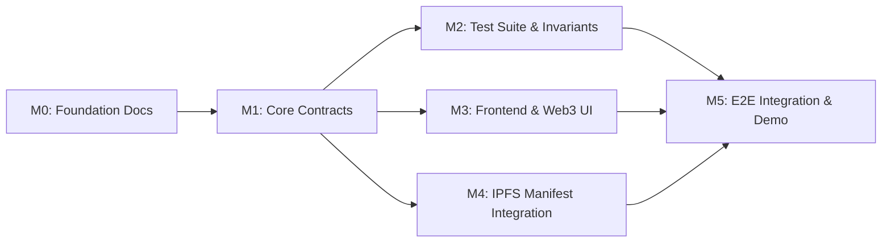

# OpenAid Protocol — Phased Implementation Plan

## 1. Overview & Phased Roadmap

This plan outlines the sequenced, dependency-driven implementation milestones for OpenAid Protocol. It translates product requirements into testable engineering deliverables for a rapid, high-assurance hackathon delivery.

---

## 2. Milestone Breakdown

### Milestone M0: Pre-Development Foundation (Current)
- **Objective:** Establish architectural specifications, threat models, state machines, contract interfaces, and development hygiene.
- **Dependencies:** None.
- **Deliverables:**
  - Complete `docs/` suite (PRD, Architecture, Threat Model, Rules, Interfaces, Workflow).
  - Repository configs: `.gitignore`, `.env.example`, `.github/workflows/ci.yml`, `AGENTS.md`.
- **Definition of Done (DoD):** All 21 foundation documents created, cross-referenced, and committed to `main`.

---

### Milestone M1: Core Smart Contract Implementation
- **Objective:** Implement modular, secure Solidity smart contracts implementing the OpenAid protocol state machine.
- **Dependencies:** M0.
- **Lead Owners:** Member 1 (Treasury/Escrow), Member 2 (Auction), Member 3 (Settlement/Quorum).
- **Deliverables:**
  1. `contracts/tokens/MockERC20.sol`: Standard 6-decimal or 18-decimal test token with minting for testing.
  2. `contracts/core/CampaignRegistry.sol`: Campaign creation, metadata anchoring, funding targets, and status queries.
  3. `contracts/core/EscrowSettlement.sol`: Purpose-bound escrow vault, donor balance tracking, pull-based refunds, and staged payouts (70/30).
  4. `contracts/core/ProcurementAuction.sol`: Commit–reveal sealed bidding, bond escrow, tie-breaking, and winner selection.
  5. `contracts/core/ValidatorRegistry.sol`: Validator set management, 3-of-5 quorum voting, and challenge handling.
  6. `contracts/interfaces/`: Formal Solidity interface definitions.
- **Definition of Done (DoD):** Contracts compile cleanly with `npx hardhat compile` with zero warnings; all interfaces conform to `docs/CONTRACT_INTERFACES.md`.

---

### Milestone M2: Comprehensive Contract Test Suite
- **Objective:** Validate functional behavior, security invariants, and adversarial edge cases across the protocol.
- **Dependencies:** M1.
- **Lead Owner:** Member 5 (QA & CI) with assistance from Members 1, 2, and 3.
- **Deliverables:**
  1. Unit tests for each contract: `test/unit/*.test.ts`.
  2. Integration tests for complete campaign lifecycle: `test/integration/Lifecycle.test.ts`.
  3. Invariant tests: Verify no balance leaks or double-withdrawals: `test/invariants/EscrowInvariants.test.ts`.
  4. Adversarial tests:
     - Unauthorized withdrawal attempts revert.
     - Double-voting reverts.
     - Out-of-order reveals revert.
     - Early challenge resolution reverts.
- **Definition of Done (DoD):** 100% passing test suite across $\ge 25$ distinct unit/integration test cases executed with `npx hardhat test`.

---

### Milestone M3: Frontend & Web3 User Interface
- **Objective:** Build an intuitive, high-contrast Web3 frontend allowing hackathon judges and users to interact in all 4 protocol roles.
- **Dependencies:** M1 (Contract ABIs).
- **Lead Owner:** Member 4 (Frontend).
- **Deliverables:**
  1. Next.js 14 App Router project setup with Tailwind CSS.
  2. RainbowKit + Wagmi wallet connection supporting local Hardhat node and Base Sepolia.
  3. Role-Based Switcher Header:
     - **Donor Portal:** Browse campaigns, donate USDC, view escrow breakdown, claim refunds.
     - **NGO Portal:** Create campaigns, specify RFPs, monitor auction and delivery status.
     - **Vendor Portal:** Submit sealed bid hash, reveal bid, submit IPFS delivery manifest, claim staged payments.
     - **Validator Portal:** Review IPFS evidence package, cast `APPROVE` / `REJECT` votes.
  4. Live countdown timers for Bidding Reveal, Delivery Deadline, and Challenge Period.
- **Definition of Done (DoD):** Frontend builds with `npm run build` and enables all 4 roles to execute their on-chain actions seamlessly.

---

### Milestone M4: Storage & Evidence Packaging (IPFS)
- **Objective:** Build a client-side IPFS evidence manifest serializer and pinning connector.
- **Dependencies:** M3.
- **Lead Owner:** Member 4 (Frontend) + Member 3 (Settlement).
- **Deliverables:**
  1. Client-side manifest generator conforming to `docs/DATA_AND_EVENTS.md`.
  2. Integration with Pinata / Web3.Storage for pinning delivery photos and geo-coordinates.
  3. Offline IPFS fallback mode for rock-solid local demo reliability (e.g. deterministic mock CIDs if external gateway times out).
- **Definition of Done (DoD):** Uploading evidence generates a valid CID, commits it on-chain, and displays previewable image assets in the validator UI.

---

### Milestone M5: End-to-End Integration, Live Demo Script & Deployment
- **Objective:** Orchestrate the complete end-to-end system, deploy to testnet, and prepare an honest, deterministic presentation.
- **Dependencies:** M1, M2, M3, M4.
- **Lead Owner:** Member 5 (QA) + Full Team.
- **Deliverables:**
  1. Automated deployment script: `scripts/deploy.ts` outputting contract addresses and updating frontend `.env`.
  2. Automated demo seed script: `scripts/seedDemo.ts` pre-populating mock campaigns, tokens, and vendor bids for fast presentation.
  3. Successful deployment to Base Sepolia or Sepolia testnet with verified contracts on block explorer.
  4. Live rehearsal of `docs/DEMO_SCRIPT.md` verifying execution in under 4 minutes.
- **Definition of Done (DoD):** Complete happy path and failure path demonstrated without manual transaction failures or unexplained delays.
