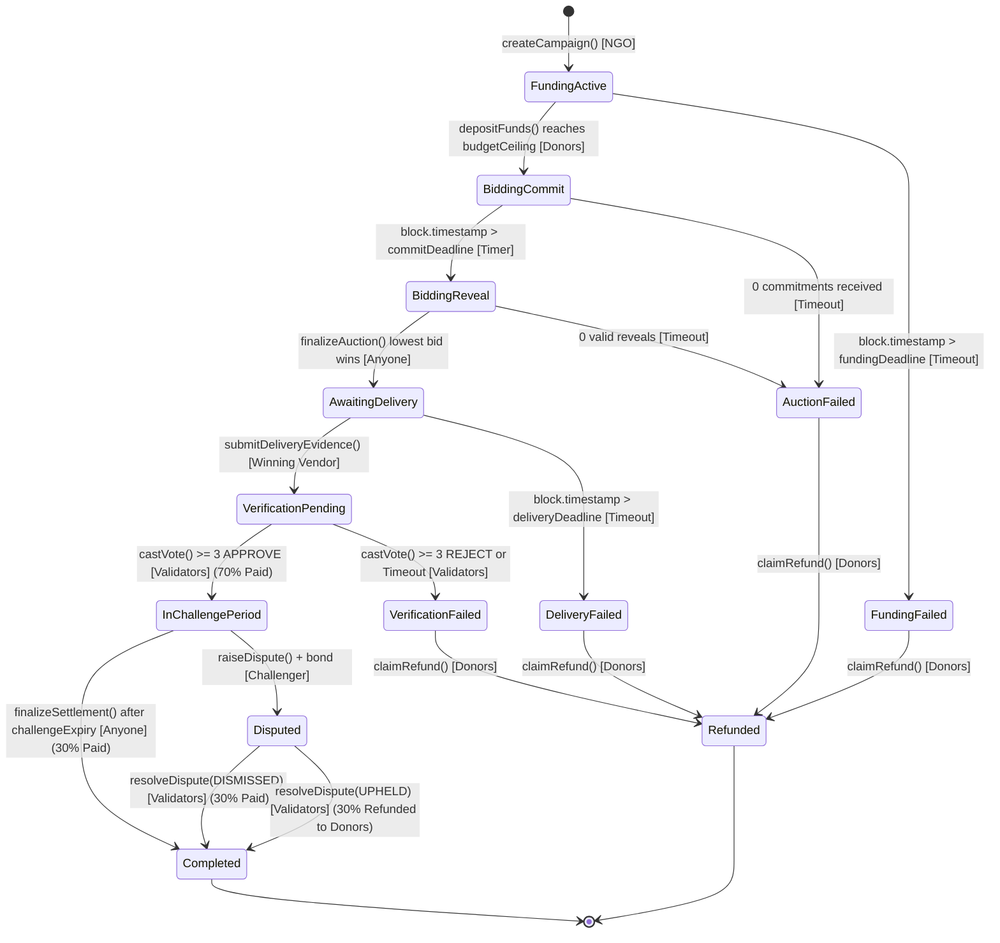

# OpenAid Protocol — Formal State Machine & Lifecycle Transitions

## 1. Lifecycle State Machine Diagram



---

## 2. State Enumeration

```solidity
enum CampaignState {
    FundingActive,        // 0: Donors contributing capital
    FundingFailed,        // 1: Deadline passed without reaching budget ceiling
    BiddingCommit,        // 2: Vendors submitting sealed bid commitments
    BiddingReveal,        // 3: Vendors revealing plain bid and salt
    AuctionFailed,        // 4: No valid revealed bids submitted
    AwaitingDelivery,     // 5: Winning vendor selected; fulfilling delivery
    DeliveryFailed,       // 6: Delivery deadline passed with no evidence submitted
    VerificationPending,  // 7: Evidence committed; validators reviewing & voting
    VerificationFailed,   // 8: 3 of 5 validators rejected evidence or voting timed out
    InChallengePeriod,    // 9: 70% released; 72h/120s timelock challenge window open
    Disputed,             // 10: Challenge raised; Stage 2 held pending dispute review
    Completed,            // 11: Final settlement completed (30% paid or refunded)
    Refunded              // 12: 100% of escrow reclaimed by donors after abort/failure
}
```

---

## 3. Detailed Transition Matrix

| Transition ID | Initial State | Target State | Trigger Function | Authorized Caller | Preconditions & Guards | Postconditions & Effects | Emitted Event | Revert Conditions |
| :--- | :--- | :--- | :--- | :--- | :--- | :--- | :--- | :--- |
| **`TR-01`** | None | `FundingActive` | `createCampaign()` | NGO Coordinator | `budgetCeiling > 0`, `fundingDeadline > block.timestamp` | Campaign struct initialized; state set to `FundingActive`. | `CampaignCreated` | `InvalidBudget()`, `InvalidDeadline()` |
| **`TR-02`** | `FundingActive` | `BiddingCommit` | `depositFunds()` | Any Donor | `block.timestamp <= fundingDeadline`, `token.transferFrom` succeeds | `totalDeposited == budgetCeiling`. Bidding commit timer starts. | `FundsDeposited`, `CampaignFunded` | `DeadlinePassed()`, `BudgetExceeded()`, `ZeroDeposit()` |
| **`TR-03`** | `FundingActive` | `FundingFailed` | `timeoutFunding()` | Anyone | `block.timestamp > fundingDeadline`, `totalDeposited < budgetCeiling` | Escrow marked for 100% refund. | `FundingFailed` | `DeadlineNotPassed()` |
| **`TR-04`** | `BiddingCommit` | `BiddingReveal` | `advanceToReveal()` | Anyone | `block.timestamp > commitDeadline`, $\ge 1$ commitment | Commit window locked; reveal window open. | `BiddingRevealOpened` | `CommitWindowActive()` |
| **`TR-05`** | `BiddingCommit` | `AuctionFailed` | `advanceToReveal()` | Anyone | `block.timestamp > commitDeadline`, zero commitments | Full campaign marked for refund. | `AuctionFailed` | `CommitWindowActive()`, `HasBids()` |
| **`TR-06`** | `BiddingReveal` | `AwaitingDelivery` | `finalizeAuction()` | Anyone | `block.timestamp > revealDeadline`, $\ge 1$ valid reveal | Lowest bidder locked as `winningVendor`; delivery clock starts. | `AuctionFinalized` | `RevealWindowActive()`, `NoValidReveals()` |
| **`TR-07`** | `BiddingReveal` | `AuctionFailed` | `finalizeAuction()` | Anyone | `block.timestamp > revealDeadline`, zero valid reveals | Full campaign marked for refund; non-revealing bonds slashed. | `AuctionFailed` | `RevealWindowActive()`, `HasWinner()` |
| **`TR-08`** | `AwaitingDelivery` | `VerificationPending`| `submitDeliveryEvidence()` | Winning Vendor | `msg.sender == winningVendor`, `block.timestamp <= deliveryDeadline` | Evidence IPFS CID anchored; validator voting window opens. | `EvidenceSubmitted` | `Unauthorized()`, `DeliveryDeadlinePassed()`, `EmptyCid()` |
| **`TR-09`** | `AwaitingDelivery` | `DeliveryFailed` | `timeoutDelivery()` | Anyone | `block.timestamp > deliveryDeadline`, no evidence submitted | Vendor bond slashed; 100% funds available for donor refund. | `DeliveryFailed` | `DeadlineNotPassed()`, `EvidenceAlreadySubmitted()` |
| **`TR-10`** | `VerificationPending`| `InChallengePeriod` | `castVote()` | Authorized Validator | `isAuthorized[msg.sender]`, `!hasVoted[msg.sender]`, 3rd APPROVE vote cast | **Stage 1 (70%) transferred to vendor**; challenge timer initialized. | `VoteCast`, `QuorumReached`, `Stage1Settled` | `UnauthorizedValidator()`, `AlreadyVoted()`, `VotingClosed()` |
| **`TR-11`** | `VerificationPending`| `VerificationFailed` | `castVote()` / `timeoutVerification()` | Authorized Validator / Anyone | 3rd REJECT vote cast OR voting deadline expired | Vendor bond slashed; 0% paid; 100% funds available for donor refund. | `VerificationFailed` | `QuorumNotMet()`, `DeadlineNotPassed()` |
| **`TR-12`** | `InChallengePeriod` | `Disputed` | `raiseDispute()` | Any Participant | `msg.sender` posts dispute bond; `block.timestamp <= challengeExpiry` | Stage 2 locked; campaign marked `Disputed`. | `DisputeRaised` | `ChallengePeriodExpired()`, `InsufficientBond()` |
| **`TR-13`** | `InChallengePeriod` | `Completed` | `finalizeSettlement()` | Anyone | `block.timestamp > challengeExpiry`, `!isDisputed` | **Stage 2 (30%) + performance bond transferred to vendor**; surplus credited to donors. | `Stage2Settled`, `CampaignCompleted` | `ChallengePeriodActive()`, `DisputePending()` |
| **`TR-14`** | `Disputed` | `Completed` (Uphold) | `resolveDispute()` | Validator Quorum | 3 of 5 validators vote to uphold dispute | 30% canceled; vendor bond slashed; surplus and 30% credited to donors. | `DisputeResolved` | `Unauthorized()`, `QuorumNotMet()` |
| **`TR-15`** | `Disputed` | `Completed` (Dismiss)| `resolveDispute()` | Validator Quorum | 3 of 5 validators vote to dismiss dispute | 30% paid to vendor; challenger bond forfeited. | `DisputeResolved`, `Stage2Settled` | `Unauthorized()`, `QuorumNotMet()` |
| **`TR-16`** | Any Failure State | `Refunded` | `claimRefund()` | Original Donor | Campaign in `FundingFailed`, `AuctionFailed`, `DeliveryFailed`, `VerificationFailed`, or `Completed` (surplus) | Proportional token balance transferred to donor. | `RefundClaimed` | `NoRefundAvailable()`, `TransferFailed()` |

---

## 4. Reversibility and Finality Rules

1. **Stage 1 Payment (70%):** **Irreversible & Final.** Once 3-of-5 validator quorum is reached and tokens are transferred to the vendor, the protocol cannot recall these funds. This provides necessary certainty for physical fulfillment logistics.
2. **Stage 2 Payment (30%):** **Conditional.** Held in escrow until the challenge window expires. Reversible only if a valid challenge is upheld by validator quorum before the deadline.
3. **Auction Selection:** **Final.** Once `finalizeAuction()` executes, the winning vendor and bid amount are immutable.
4. **Donor Refunds:** **Final.** Once claimed, tokens are withdrawn from the contract to the donor wallet.
