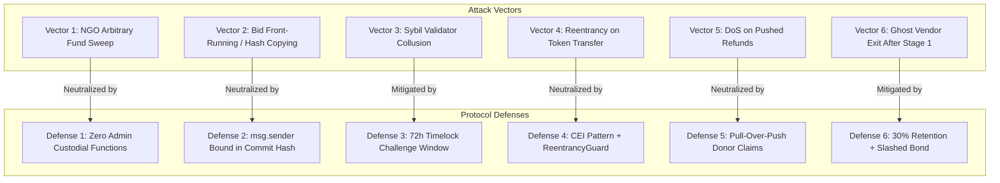

# OpenAid Protocol — Comprehensive Threat Model

## 1. Asset Classification & Security Boundaries

OpenAid Protocol secures financial capital and coordination integrity across adversarial, multi-stakeholder humanitarian environments.

### 1.1. Critical Assets to Protect
1. **Escrowed Donor Capital (Tier 1 - Critical):** ERC-20 tokens deposited by donors, held in `EscrowSettlement.sol`.
2. **Vendor Collateral & Bid Bonds (Tier 1 - Critical):** Performance bonds deposited by vendors during the procurement auction.
3. **Settlement Payout Integrity (Tier 1 - Critical):** Assurance that Stage 1 (70%) and Stage 2 (30%) disbursements are released *only* to the authenticated winning vendor upon meeting threshold conditions.
4. **Donor Refund Entitlement (Tier 2 - High):** Guaranteed ability for original donors to pull 100% of their deposits if campaigns fail, abort, or time out.
5. **Auction Privacy & Fairness (Tier 2 - High):** Prevention of bid leaks, front-running, or copy-cat bids prior to the reveal deadline.
6. **Delivery Evidence Authenticity (Tier 3 - Medium):** Tamper-evident anchoring of IPFS manifests representing physical delivery claims.

---

## 2. Threat Actor Taxonomy

| Actor Profile | Capabilities & Resources | Primary Motivations | Potential Attack Objectives |
| :--- | :--- | :--- | :--- |
| **Rogue / Compromised NGO** | Contract deployer or campaign initiator; possesses campaign management keys. | Financial greed; organizational insolvency; external extortion. | Attempt to redirect escrowed funds to personal wallets; cancel funded campaigns to steal deposits; award tenders to accomplice vendors. |
| **Fraudulent Vendor** | Submits bids; operates logistics; holds private signing keys. | Profit extraction with minimal or zero physical delivery expenditure. | Submit artificially low bids; upload fabricated photos/receipts; claim Stage 1 (70%) payout and vanish; stall challenge period. |
| **Colluding Validators** | 1 to 5 registered validator keys; access to IPFS manifests. | Bribery; kickbacks from corrupt vendors; ideological bias. | Form a 3-of-5 cartel to attest to fraudulent delivery manifests; falsely reject honest vendors to extract extortion payments. |
| **MEV Searcher / Mempool Sniper** | Monitors public mempool; can reorder, insert, or censor transactions. | Arbitrage; fee extraction; bid poaching. | Front-run commit transactions; copy vendor commitment hashes; exploit slippage or timing vulnerabilities. |
| **Griefing Donor / External Attacker** | Arbitrary smart contract caller; flash loan capital; automated scripts. | Protocol disruption; denial-of-service; reputational damage. | Force recipient contracts to revert during mass refund distributions (DoS); submit bogus dispute bonds to freeze honest vendor settlements. |

---

## 3. Attack Scenarios & Mitigations

### Scenario 1: NGO Attempts Direct Fund Exfiltration
- **Attack Mechanism:** An NGO creates a campaign, attracts \$100,000 in donor deposits, and invokes an administrative function to sweep or redirect tokens to a private treasury.
- **Protocol Defense:** `EscrowSettlement` contains **no sweeping function, no owner withdrawal function, and no rescue logic**. Tokens can only be transferred to `winningVendor` (via staged settlement) or `donor` (via refund claim). Transactions from the NGO attempting unauthorized access revert immediately.

### Scenario 2: Bid Front-Running and Copy-Cat Commitments
- **Attack Mechanism:** An honest vendor submits a commitment hash to the mempool. An MEV bot copies the exact hash and submits it with higher gas to claim the bid.
- **Protocol Defense:** The commitment hash is strictly parameterized by `msg.sender`:
  $$\text{hash} = \text{keccak256}(\text{abi.encodePacked}(\text{bidAmount}, \text{salt}, \text{msg.sender}))$$
  If an attacker submits the identical hash from their own address, the reveal validation will calculate `keccak256(bidAmount, salt, attackerAddress) \neq \text{hash}`, causing the attacker's reveal to fail and their bid bond to be forfeited.

### Scenario 3: Corrupt Validator Quorum Collusion (3 of 5)
- **Attack Mechanism:** A malicious vendor bribes 3 out of 5 registered validators to vote `APPROVE` on a fake IPFS manifest containing stock images.
- **Protocol Defense:**
  1. The 70/30 split ensures the vendor only receives 70% in Stage 1, while 30% and their performance bond remain locked.
  2. The mandatory **Challenge Window (72 hours)** opens immediately upon quorum.
  3. Donors, community members, or the remaining honest validators can review the public IPFS manifest and call `raiseDispute()` with counter-evidence, freezing Stage 2 funds.
  4. Collusion risk is documented as a fundamental boundary of multi-sig consensus; future iterations will integrate decentralized staking/slashing (e.g. EigenLayer AVS).

### Scenario 4: Reentrancy Attack on Token Settlement
- **Attack Mechanism:** An attacker uses a malicious contract that acts as a vendor or donor and implements a fallback/receive function that re-enters `executeStage1Settlement` or `claimRefund` before state variables update.
- **Protocol Defense:**
  1. Strict adherence to **Checks-Effects-Interactions (CEI)**: Internal balances and state flags are zeroed *before* any external token transfer.
  2. All external state-changing functions are decorated with OpenZeppelin's `nonReentrant` modifier.
  3. Token interactions use `SafeERC20` exclusively.

### Scenario 5: Denial-of-Service via Reverting Donor Contracts
- **Attack Mechanism:** An attacker deposits funds into a campaign using a smart contract that explicitly reverts on token transfers. If the campaign fails and the contract iterates through a loop pushing refunds to all donors, the attacker's revert bricks the refund loop for all other donors.
- **Protocol Defense:** OpenAid uses a **Pull-over-Push** refund pattern (`RULE-REF-01`). There is no global refund iteration loop. Each donor calls `claimRefund(campaignId)` individually to withdraw their balance. A failing caller affects only their own transaction.

### Scenario 6: Ghost Vendor Exit after Stage 1 (70%)
- **Attack Mechanism:** A vendor fulfills low-cost partial supplies, claims Stage 1 (70%), and abandons the remaining deliverables.
- **Protocol Defense:**
  - Stage 1 is sized at 70% precisely to cover estimated wholesale cost-of-goods, eliminating vendor windfall profits.
  - The remaining 30% profit margin plus the vendor's 5% `bidBond` remain locked in escrow. Abandonment results in total forfeiture of the 30% retention and performance bond, rendering ghost fulfillment economically irrational.
