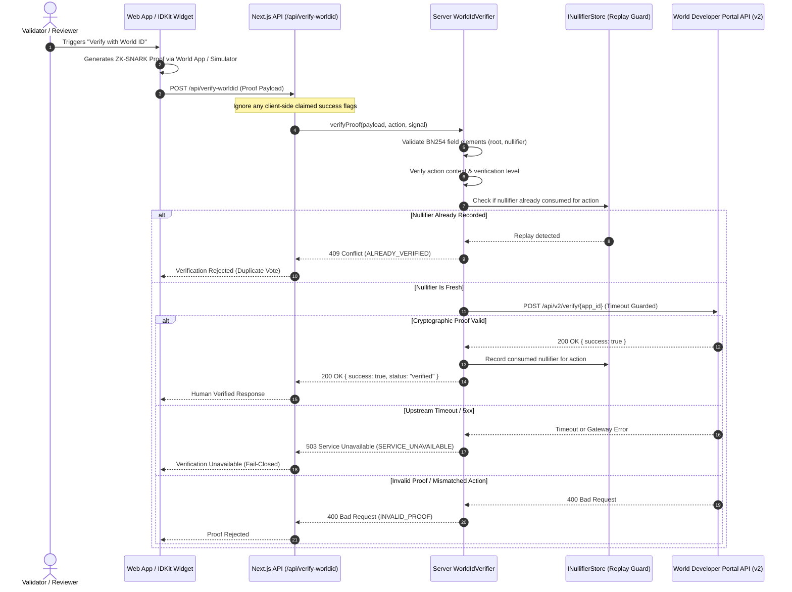

# World IDKit Integration Guide — OpenAid Protocol

This guide documents the production-grade zero-knowledge proof verification architecture implemented for World ID within the OpenAid Protocol.

---

## 1. Overview & Protocol Security Role

In OpenAid Protocol, human reviewers (validators casting quorum attestations and community auditors raising delivery dispute challenges) are guarded by **World ID zero-knowledge personhood proofs**.

### Purpose
- **Sybil Resistance:** Guarantees that each vote in the 3-of-5 validator quorum originates from an authentic, distinct human identity, preventing botnets and automated AI swarms from forging attestations.
- **Privacy-Preserving:** Zero-knowledge proofs reveal no real names, iris scans, biometric data, wallet associations, or physical identities to OpenAid Protocol or observers.
- **Fail-Closed Security:** The backend never turns network timeouts or upstream service failures into verified statuses, and ignores any client-side claimed verification flags.

---

## 2. Architecture & Verification Flow



---

## 3. Cryptographic Verification & Semaphore Semantics

World ID proofs are Semaphore zero-knowledge proofs computed over the **BN254 (alt_bn128)** elliptic curve:

1. **Scalar Field Bounds ($r$):**
   Roots and nullifiers must be valid scalar field elements strictly less than:
   $$\text{SNARK\_SCALAR\_FIELD} = 21888242871839275222246405745257275088548364400416034343698204186575808495617$$
   Any input outside this scalar field is rejected immediately with `INVALID_PAYLOAD`.

2. **Nullifier Hash & Scoping:**
   $$\text{nullifier\_hash} = \text{hash}(\text{identity\_nullifier}, \text{external\_nullifier})$$
   where $\text{external\_nullifier} = \text{hash}(\text{app\_id}, \text{action})$.  
   Because the nullifier is cryptographically deterministic per action, a human produces the exact same nullifier hash for that action. Replay attacks are defeated by storing consumed nullifiers keyed to `action:nullifier_hash`.

3. **Signal Hashing:**
   The verification payload binds contextual intent (such as the validator's address or vote signal) to prevent front-running and proof recycling across different actions. The signal is hashed into a field element using `@worldcoin/idkit-core/hashing`:
   $$\text{signal\_hash} = \text{hashToField}(\text{signal}).\text{digest}$$

---

## 4. Configuration & Environment Variables

Public identifiers (`NEXT_PUBLIC_WORLD_ID_APP_ID`) are used by the client-side IDKit widget to request proofs. Server-side verification reads configuration from environment variables with fallback hierarchy:

| Environment Variable | Required | Default Value | Description |
|---|---|---|---|
| `WORLD_ID_APP_ID` | Optional | `NEXT_PUBLIC_WORLD_ID_APP_ID` | App ID registered on Worldcoin Developer Portal (e.g. `app_staging_...` or `app_...`). |
| `NEXT_PUBLIC_WORLD_ID_APP_ID` | Yes | — | Public client App ID for IDKit widget. |
| `WORLD_ID_ACTION` | Optional | `NEXT_PUBLIC_WORLD_ID_ACTION` | Target action identifier (default: `verify-human-reviewer`). |
| `NEXT_PUBLIC_WORLD_ID_ACTION` | Optional | `verify-human-reviewer` | Action context passed to client widget. |
| `WORLD_ID_API_URL` | Optional | `https://developer.worldcoin.org/api/v2/verify` | Upstream verification endpoint URL. |
| `WORLD_ID_REQUEST_TIMEOUT_MS` | Optional | `8000` | Timeout threshold in milliseconds for upstream calls before aborting. |
| `WORLD_ID_MINIMUM_LEVEL` | Optional | `orb` | Minimum allowed verification tier (`orb` or `device`). |

> [!IMPORTANT]
> **No Mock Bypass in Production:** When `WORLD_ID_APP_ID` is set to an unconfigured placeholder or missing, the server fails closed with `503 Service Unavailable` (`CONFIGURATION_ERROR`), rather than pretending verification succeeded.

---

## 5. Testing with World ID Simulator (No Biometrics Required)

Developers can verify genuine zero-knowledge proofs in staging and hackathon test environments without physical Iris-scan Orb hardware:

1. **Register Staging App:**
   - Navigate to the [Worldcoin Developer Portal](https://developer.worldcoin.org).
   - Create a new project configured in **Staging** mode.
   - Create an Action named `verify-human-reviewer`.
   - Copy the App ID (`app_staging_...`).

2. **Open World ID Simulator:**
   - Visit [simulator.worldcoin.org](https://simulator.worldcoin.org).
   - The simulator acts as a virtual World App wallet capable of generating mathematically valid Groth16 Semaphore proofs for staging app IDs.

3. **Configure Environment:**
   ```bash
   WORLD_ID_APP_ID="app_staging_your_app_id"
   NEXT_PUBLIC_WORLD_ID_APP_ID="app_staging_your_app_id"
   WORLD_ID_ACTION="verify-human-reviewer"
   ```

---

## 6. API Route Specification (`POST /api/verify-worldid`)

### Request Formats Supported

The route supports both standard IDKit widget responses (nested) and flat payload formats:

#### Nested Format (IDKit SDK)
```json
{
  "proof": {
    "merkle_root": "0x1f8b4c7d...",
    "nullifier_hash": "0x2a9e7f4c...",
    "proof": "0x3b8d6f2e...",
    "verification_level": "orb"
  },
  "action": "verify-human-reviewer",
  "signal": "0xvalidator1_vote"
}
```

#### Flat Format
```json
{
  "merkle_root": "0x1f8b4c7d...",
  "nullifier_hash": "0x2a9e7f4c...",
  "proof": "0x3b8d6f2e...",
  "verification_level": "orb",
  "action": "verify-human-reviewer",
  "signal": "0xvalidator1_vote"
}
```

### Responses

#### `200 OK` (Verified)
```json
{
  "success": true,
  "status": "verified",
  "nullifier_hash": "0x2a9e7f4c...",
  "action": "verify-human-reviewer",
  "verification_level": "orb",
  "timestamp": "2026-11-06T12:00:00.000Z"
}
```

#### `400 Bad Request` (Invalid Proof or Payload)
```json
{
  "success": false,
  "status": "rejected",
  "error_code": "INVALID_PROOF",
  "error_message": "The zero-knowledge proof verification failed cryptographically.",
  "upstream_code": "invalid_proof",
  "timestamp": "2026-11-06T12:00:00.000Z"
}
```

#### `409 Conflict` (Replay / Double-Voting)
```json
{
  "success": false,
  "status": "rejected",
  "error_code": "ALREADY_VERIFIED",
  "error_message": "Nullifier already consumed: This unique human identity has already attested for this action.",
  "nullifier_hash": "0x2a9e7f4c...",
  "action": "verify-human-reviewer",
  "timestamp": "2026-11-06T12:00:00.000Z"
}
```

#### `503 Service Unavailable` (Upstream Failure / Timeout / Unconfigured)
```json
{
  "success": false,
  "status": "verification-unavailable",
  "error_code": "SERVICE_UNAVAILABLE",
  "error_message": "World ID verification timed out after 8000ms.",
  "timestamp": "2026-11-06T12:00:00.000Z"
}
```

---

## 7. Security Invariants Verified by Tests

The test suite in [`test/worldid.test.ts`](file:///c:/Users/suyas/OneDrive/Desktop/pravaha/EthGlobal_Pravaha/test/worldid.test.ts) and [`test/validator-selection.test.ts`](file:///c:/Users/suyas/OneDrive/Desktop/pravaha/EthGlobal_Pravaha/test/validator-selection.test.ts) exercises:
1. **BN254 Scalar Field Adherence:** Rejects non-hex, empty, and out-of-field elements $\ge r$.
2. **Action Binding:** Rejects proof if caller context differs from expected action.
3. **Nullifier Replay Protection:** Prevents duplicate voting with identical nullifier for an action.
4. **Fail-Closed Guarantees:** Upstream timeouts (via `AbortSignal`) and 5xx errors return `verification-unavailable`, never converting a failure into success.
5. **No Client Spoofing:** Forged client claims (`{ "success": true }`) without valid cryptographic verification are rejected.
6. **Security Headers:** Enforces `Cache-Control: no-store, no-cache, must-revalidate` and `X-Content-Type-Options: nosniff`.

---

## 8. Integration Debrief & Developer Feedback (ETHGlobal Mumbai Track Requirements)

### 1. Time to First Success
- **Setup Time:** ~35 minutes from initial Worldcoin Developer Portal staging app registration to successfully executing our first end-to-end ZK proof roundtrip through the Next.js API verifier using the World ID Simulator.
- **Key Enabler:** The cloud-hosted World ID Simulator (`simulator.worldcoin.org`) was indispensable for rapid developer prototyping without requiring physical Orb hardware on the hackathon floor.

### 2. Integration Friction Points Encountered
1. **Field Element Bounds in TypeScript:**
   - *Friction:* JavaScript numbers cannot represent 256-bit prime scalar field elements ($r = 21888242871839275222246405745257275088548364400416034343698204186575808495617$). When integrating Semaphore proofs, malformed hex or values $\ge r$ can cause silent upstream failures.
   - *Mitigation:* We authored an explicit `isValidFieldElement` validation utility with BigInt modulus boundary checks on the server before transmitting payloads.
2. **Action Digest Formatting:**
   - *Friction:* Nuances between raw UTF-8 action strings and 32-byte keccak256 hash digests when binding complex sub-vault identifiers (`campaignId`, `subVaultId`, `deliveryManifestCid`).
   - *Recommendation for World:* Expand `@worldcoin/idkit-core` documentation to provide explicit best practices for binding multi-variable on-chain tuples into World ID actions.
3. **Graceful Offline Fallbacks in CI/Testing:**
   - *Friction:* Running headless unit tests in CI environments without external internet access requires mock fetch wrappers to avoid network timeouts.
   - *Recommendation for World:* Distribute an official `@worldcoin/idkit-mock` testing harness for deterministic local CI/CD pipelines.

### 3. Minimum Sufficient Assurance Rationale
- **Validator Quorum (Biometric / Orb Level):** Disbursing thousands of USDC in donor capital requires the highest tier of Sybil resistance. Device-level proofs are strictly rejected for validator quorum votes to eliminate automated bot collusion.
- **Recipient Delivery Receipts (Device Level Permitted in Crisis):** On-the-ground beneficiaries in disaster zones may lack immediate access to biometric Orb centers; hence device-level identity receipts provide bounded evidence to the human review panel without directly releasing funds.
